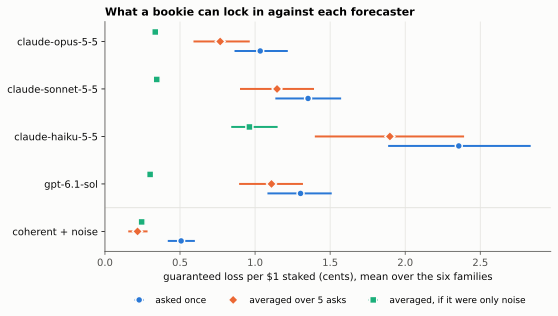
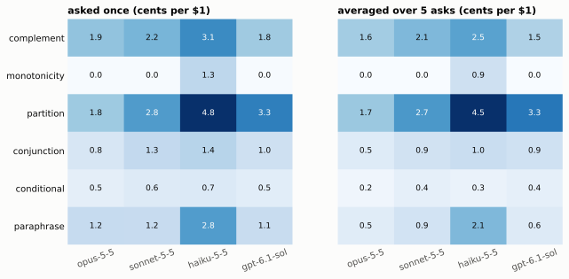
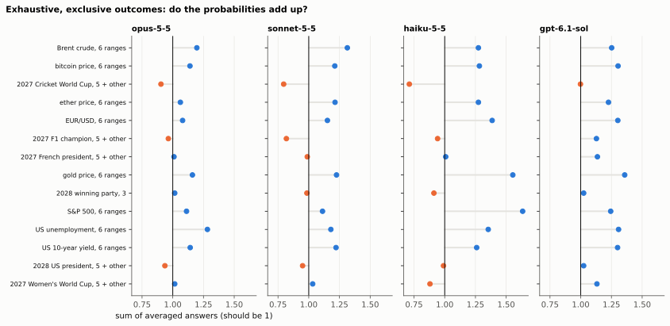
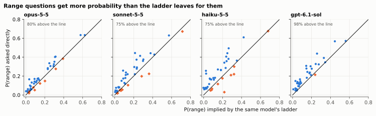
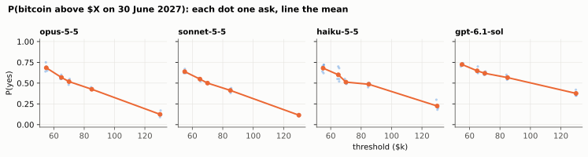
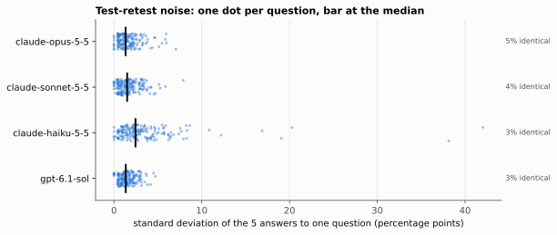
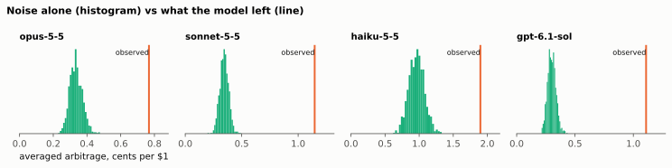
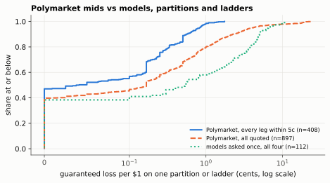

<p align="center"></p>

# dutchbook

dutchbook checks whether a language model's probabilities agree with each other. It asks for the probability of 176 logically related propositions about things that haven't happened yet, each one in its own fresh conversation, and then looks for answers that break the rules of probability. When they do, it prices a Dutch book: a set of bets, at the model's own prices, that loses money however the world turns out. The score is how many cents per dollar staked a bookie can lock in. Coherence needs no ground truth, so the questions can be about 2027 and 2028 and no model can have seen the answers in training.

## Why I built this

Most forecasting evals for LLMs wait for questions to resolve and then score accuracy. That takes months, and every resolved question leaks into the next round of training data. I wanted a test that works today on questions nobody knows the answer to.

Coherence is that test. If a model says Bitcoin has a 30% chance of finishing June 2027 above $85k and a 40% chance of finishing above $130k, I don't need to wait until June to know something is wrong. And if it says those things in separate conversations, that's arguably the more honest test. It's how people actually use these models: one question at a time, with no memory of the last answer.

The part I cared most about was noise. Ask a model the same question five times and you get five slightly different numbers. Two noisy answers to linked questions will almost never line up exactly, so a naive coherence score mostly measures sampling noise. I wanted to know how much incoherence is left once you account for that.

## Short version of what I found

Four models, 176 propositions, each asked 5 times: 3,520 answers. All numbers are cents of guaranteed loss per $1 of total stake, averaged over the six constraint families, with 95% intervals from a bootstrap over topics.

- **Every model is incoherent beyond its own noise.** After averaging the five answers to each question, a bookie still locks in 0.8 [0.6, 1.0] cents per dollar against Claude Opus 5.5, 1.1 [0.9, 1.4] against Sonnet 5.5, 1.1 [0.9, 1.3] against GPT-6.1 Sol and 1.9 [1.4, 2.4] against Haiku 5.5. A forecaster with coherent beliefs and the same noise would leave 0.3, 0.3, 0.3 and 1.0. None of 1,000 noise-only simulations reached the observed value for any model (p ≤ 0.001).
- **Asked once, the numbers are 1.0, 1.4, 1.3 and 2.4 cents.** Half or more of that is noise. For Haiku, noise alone accounts for 92% of it, for Opus 74%, and for Sonnet and GPT-6.1 Sol a little over half.
- **Opus is the most coherent; Sonnet and GPT-6.1 Sol can't be told apart.** Opus beats Sonnet by 0.4 [0.1, 0.6] cents after averaging and GPT-6.1 Sol by 0.3 [0.2, 0.5]. Sonnet minus GPT-6.1 Sol is 0.0 [−0.2, 0.3]. Haiku is the least coherent by about a cent, but most of the gap is its larger noise. Its excess over noise isn't distinguishable from Sonnet's or GPT-6.1 Sol's.
- **The biggest source is numeric range questions, which add up to more than 1.** Ask for the chance that the S&P 500, Bitcoin or the unemployment rate lands in each of six ranges, and the six answers sum to 1.15 on average for Opus, 1.20 for Sonnet, 1.29 for GPT-6.1 Sol and 1.38 for Haiku. That's true for every one of the eight quantities for every model. Each range gets 1.2 to 1.6 times the probability that the same model's own threshold ladder leaves for it. This is the unpacking effect that Tversky and Koehler found in people in 1994.
- **Lists of named candidates don't show it.** Who wins the 2028 US election, the 2027 F1 title or the cricket World Cup, with five names and "someone else", sums to between 0.91 and 1.07 on average.
- **Threshold ladders are almost perfectly ordered.** After averaging, Opus, Sonnet and GPT-6.1 Sol never price "above $X" higher than "above" a lower $X, or "by an earlier date" higher than "by a later one", across all 14 ladders. Single asks slip by a fraction of a cent now and then. Haiku's averaged answers invert three ladders. Conditional questions, P(A | B) against P(A and B) and P(B), show no incoherence beyond noise for any model.
- **Complements lean in opposite directions by model family.** A question and its negation, such as "above $X" and "at or below $X", sum slightly under 1 on average for the Claude models (0.95 to 1.00 depending on the kind of question) and slightly over for GPT-6.1 Sol (1.02 to 1.04 on numeric and dated questions, over 1 on 15 of 16 numeric pairs and all 6 dated ones).
- **Liquid prediction markets are an order of magnitude more coherent.** On Polymarket the same kind of book, priced at the mid, takes 0.19 cents per dollar from the 350 outcome lists and the 58 threshold ladders where every leg is quoted within 5 cents. The models' range-and-list books take 1.7 to 4.5 cents after averaging. A book you could actually execute, buying at the ask and selling at the bid, existed in 19 of those 350 lists, and the largest was worth 0.2 cents per dollar before fees.
- **No refusals and no format failures.** All 3,520 replies ended in a valid `<probability>` tag, and no call recorded a tool event.

## Contents

- [How it works](#how-it-works)
- [Results](#results)
- [How the models were called](#how-the-models-were-called)
- [Limitations](#limitations)
- [Quickstart](#quickstart)
- [Layout](#layout)
- [Tests](#tests)

## How it works

### The questions

The bank is generated from templates with a seed, so every logical relation holds by construction. A relation isn't a rule I typed in next to two questions. Each question is a 0/1 indicator over an explicit list of possible worlds, and the solver works out what follows. The committed bank is seed 20261103: 176 propositions in 75 items.

| family | items | example |
| :--- | ---: | :--- |
| complement | 27 | "Will Brent be above $110 on 30 June 2027?" and "at or below $110"; "Will JD Vance win?" and "Will someone other than JD Vance win?"; "Will X happen by D?" and "Will the period to D pass without X?" |
| monotonicity | 14 | P(BTC above $55k), P(above $65k), ... P(above $130k) on the same date, for eight quantities; P(crewed Starship orbit by 30 June 2027), by end 2028, by end 2030, for six events |
| partition | 14 | the six ranges cut by those five thresholds; five named candidates plus "someone other than" them, for five contests; the winning party in 2028 |
| conjunction | 6 | A, B, A and B, A or B, where A and B come from unrelated topics |
| conditional | 6 | P(A \| B), P(A and B), P(B), where the conditional question says it is void if B fails |
| paraphrase | 8 | the same threshold question in different words |

The eight quantities are Bitcoin, ether, the S&P 500, gold, Brent crude, the US 10-year yield, US unemployment and EUR/USD, all measured on or for 30 June 2027 against a named source. The thresholds come from a grid around each quantity's value on 3 November 2026. The six dated events are a crewed Starship orbit, a crewed Moon landing, Bitcoin reaching $150k, a 20% S&P 500 drawdown, a new WHO public health emergency and a UK application to rejoin the EU. The contests are the 2028 US presidential election, the 2027 French presidential election, the 2027 F1 championship, the 2027 men's Cricket World Cup and the 2027 Women's World Cup. A new seed draws new thresholds, dates, named candidates and pairs, so a fresh set of questions with the same structure is one command away.

The proposition ids say what each question means (`btc.gt.85000`, `btc.bin.65000_to_70000`, `moon.by.2029-12-31`, `us2028.win.jd_vance`). A test decodes every id, draws random outcomes for the world, and checks that every item's indicators agree with the meaning in some world, and that every world is reachable.

### Asking

Every call is a fresh conversation with the same system prompt, which gives the date as 3 November 2026 and says there are no tools. The user message is the question and this instruction:

```
Give your probability that the answer is yes. You may reason briefly first. End your
reply with your final answer on its own line, in exactly this format:
<probability>0.XX</probability>
The number must be a decimal between 0 and 1. If you are unsure, give your best
estimate anyway.
```

The parser is strict. It wants exactly one tag around a plain decimal in [0, 1]. A missing tag, two tags, `40%` or `about 0.4` is a failure, sorted into refusal, no tag, multiple tags or bad number. A failed parse is never retried, because retrying would hide exactly the failures the benchmark counts. A transport failure, meaning the CLI crashed, timed out or hit a rate limit, is retried with backoff and never scored. Both kinds are recorded.

Each of the 176 propositions was asked 5 times per model, in a shuffled order so repeats are spread out. Every request and response is a line of JSON in [`data/recordings/`](data/recordings), with the system prompt, the user prompt, the CLI arguments, the reply and the CLI's own output.

### The Dutch book

For an item with worlds w and claims i at the model's prices p_i, a contract on claim i pays $1 if the claim is true. The bookie buys (s_i > 0) or sells (s_i < 0) contracts at the model's price and earns Σ s_i (1[i true in w] − p_i) in world w. For a conditional claim P(A | B) the bet is called off when B is false, which is de Finetti's conditional bet. The book is the linear program

```
maximise t   subject to   Σ_i s_i g_i(w) ≥ t  in every world w,   Σ_i |s_i| ≤ 1
```

solved with HiGHS. t is the guaranteed profit per $1 of total contract face value, and t > 0 exactly when the prices are incoherent. For unconditional claims, LP duality gives a second reading: t is the L∞ distance from the prices to the nearest coherent assignment, the most any one price has to move. The tests check that identity against a separate LP on random prices. As an example, answering 0.6 to "above $110" and 0.6 to "at or below $110" lets the bookie sell half a contract on each side, take in 60 cents and pay out 50 in either world: 10 cents per dollar.

The report also gives the Euclidean distance to the nearest coherent assignment. That projection has a guarantee of its own (Predd et al. 2009): moving to it lowers the Brier score in every world by at least the squared distance.

The unit tests check the solver against hand-worked cases for each family, including a conditional whose optimum of 1/14 is proved by a matching dual. The simple shapes (partitions, nested ladders, paraphrase pairs) have closed forms, which the noise simulation uses because it solves thousands of books per item. Each closed form is tested against the LP.

### Noise and incoherence

Each item is scored three ways:

1. **Asked once.** Take repeat r of every proposition and price the book, for r = 1 to 5, and average. This is what someone asking each question once would face.
2. **Averaged.** Average the five answers to each proposition first, then price the book. Averaging cancels most of the noise.
3. **Noise only.** Take the nearest coherent assignment to the averaged answers and treat it as the model's true beliefs. Add Gaussian noise with each proposition's own spread, average five draws, price the book, and repeat 1,000 times. That gives the arbitrage a perfectly coherent forecaster with this model's noise would leave, both asked once and averaged.

The gap between 2 and 3 is the excess: incoherence that noise doesn't explain. The pooled p-value compares the observed total with the 1,000 simulated totals, and item-level p-values go through Benjamini-Hochberg at q = 0.05.

One detail matters a lot. Five answers give a poor estimate of one proposition's spread, and plugging that estimate straight into the null makes it too narrow. On simulated coherent forecasters, my first version flagged pure noise as incoherent far more often than 5% of the time. Each proposition's variance is now shrunk towards the model's pooled variance, as in a moderated t-test, with the pooled value worth 4 degrees of freedom. A test checks that on a noisy coherent forecaster with five asks, fewer than 10% of items come out significant at 5%. A second null that uses the pooled spread for every proposition gives the same conclusion (p ≤ 0.001 for every model).

The baselines go through the same pipeline. The coherent forecaster draws one joint distribution over every topic and reads every answer off it. It scores exactly 0. "Coherent + noise" adds noise with roughly the models' median spread, and the random forecaster answers uniformly at random.

## Results

Every number here is in [`results/report.md`](results/report.md) and [`results/summary.json`](results/summary.json). Per-item scores are in [`results/items.csv`](results/items.csv) and every answer is in [`results/answers.csv`](results/answers.csv). `uv run dutchbook report` rebuilds all of it from the recordings.

### Headline



| forecaster | asked once | noise only, asked once | averaged | noise only, averaged | excess over noise |
| :--- | ---: | ---: | ---: | ---: | ---: |
| claude-opus-5-5 | 1.0 [0.9, 1.2] | 0.8 | 0.8 [0.6, 1.0] | 0.3 | 0.4 [0.3, 0.6] |
| claude-sonnet-5-5 | 1.4 [1.1, 1.6] | 0.8 | 1.1 [0.9, 1.4] | 0.3 | 0.8 [0.5, 1.0] |
| claude-haiku-5-5 | 2.4 [1.9, 2.8] | 2.2 | 1.9 [1.4, 2.4] | 1.0 | 0.9 [0.5, 1.4] |
| gpt-6.1-sol | 1.3 [1.1, 1.5] | 0.7 | 1.1 [0.9, 1.3] | 0.3 | 0.8 [0.6, 1.0] |
| coherent | 0 | 0 | 0 | 0 | 0 |
| coherent + noise | 0.5 [0.4, 0.6] | 0.6 | 0.2 [0.2, 0.3] | 0.2 | 0.0 [−0.1, 0.0] |
| random | 22.0 [20.4, 23.5] | 15.4 | 12.1 [10.6, 13.6] | 6.8 | 5.3 [3.9, 6.7] |

Cents per $1, mean over the six families so the 27 complement items don't drown out the 6 conditional ones. The random forecaster is left off the chart because it would flatten everything else. The noise columns are the means of the simulated nulls; their intervals are in the report.

The coherent-plus-noise row shows the method working. Its asked-once arbitrage is real money, half a cent, but the null explains all of it, and its excess is zero. The models' excess is not.

### Where the incoherence lives



Averaged, in cents per $1:

| family | opus | sonnet | haiku | gpt-6.1-sol | items beyond noise (opus / sonnet / haiku / gpt) |
| :--- | ---: | ---: | ---: | ---: | :--- |
| complement | 1.6 | 2.1 | 2.5 | 1.5 | 10, 14, 2, 13 of 27 |
| monotonicity | 0.0 | 0.0 | 0.9 | 0.0 | 0, 0, 1, 0 of 14 |
| partition | 1.7 | 2.7 | 4.5 | 3.3 | 10, 11, 8, 11 of 14 |
| conjunction | 0.5 | 0.9 | 1.0 | 0.9 | 1, 3, 0, 3 of 6 |
| conditional | 0.2 | 0.4 | 0.3 | 0.4 | 0, 1, 0, 0 of 6 |
| paraphrase | 0.5 | 0.9 | 2.1 | 0.6 | 0, 2, 1, 0 of 8 |

Partitions dominate, and within partitions it's the numeric ranges:



Every model over-sums every set of numeric ranges. The who-wins lists sit close to 1, and the Claude models tend to leave them a little short. A threshold ladder is a cleaner way to see the effect. "Above $65k" minus "above $70k" is the probability the model itself implies for the $65k to $70k range. Asked about that range directly, it gives more:



| | opus | sonnet | haiku | gpt-6.1-sol |
| :--- | ---: | ---: | ---: | ---: |
| ranges above the ladder's value | 80% | 75% | 75% | 98% |
| median ratio, asked to implied | 1.23 | 1.25 | 1.64 | 1.53 |
| mean sum over six ranges | 1.15 | 1.20 | 1.38 | 1.29 |

The ladders themselves are fine. After averaging, Opus, Sonnet and GPT-6.1 Sol never priced a higher threshold above a lower one, and no model priced an earlier deadline above a later one. Single asks produced six small inversions between them, none over 0.4 cents. Haiku's averaged answers invert two ladders by 6 to 7 cents. EUR/USD is one of the polarity slips described under Noise. The S&P 500 inversion is a steady mistake. Four times out of five Haiku put "above 9,600" at 0.3 or more, while it put "above 9,000" at about 0.12.



So the models hold a sensible distribution for each quantity and can report its tail probabilities consistently. They lose it when a question names a range. My guess is that a range question invites the model to argue for that range ("Bitcoin could plausibly trade between $70k and $85k...") in a way a threshold question doesn't. That's the support-theory account of the same effect in people.

### Noise



| | opus | sonnet | haiku | gpt-6.1-sol |
| :--- | ---: | ---: | ---: | ---: |
| median SD of 5 answers (pp) | 1.3 | 1.5 | 2.4 | 1.3 |
| mean SD (pp) | 1.6 | 1.7 | 3.6 | 1.5 |
| identical all 5 times | 5% | 4% | 3% | 3% |
| share of asked-once arbitrage that noise explains | 74% | 58% | 92% | 52% |

Test-retest noise is small, a median of 1.3 to 2.4 percentage points, and no model gives the same number five times in a row on more than 5% of questions. Part of Haiku's long tail is answers to the wrong question. On "Will the euro be above 0.97 dollars on 30 June 2027?" it said 0.98, 0.96, 0.97 and 0.97, and once 0.03. That reply reasons correctly that a fall below 0.97 is unlikely and then reports the probability of the fall. On "Will the period to 2029 pass without a new WHO emergency?" one reply works out that the chance of no declaration is about 0.2, then reports 0.73. The noise null counts these slips as noise, which is generous to Haiku.



### Against a prediction market



I took one snapshot of Polymarket's public Gamma API on 3 November 2026 and kept every negRisk event (mutually exclusive outcomes) and every threshold ladder ("Bitcoin above ___ on November 8?", "What price will Bitcoin hit in November?"). Each becomes the same kind of item and goes through the same solver, once at the mid and once at the bid and ask.

| | markets | mid book, mean | mid book, median | executable books | largest executable |
| :--- | ---: | ---: | ---: | ---: | ---: |
| outcome lists, every leg within 5c | 350 | 0.19 | 0.06 | 19 | 0.20 |
| outcome lists, all quoted | 714 | 0.78 | 0.17 | 21 | 0.62 |
| ladders, every leg within 5c | 58 | 0.19 | 0.00 | 5 | 0.50 |
| ladders, all quoted | 183 | 1.83 | 0.00 | 7 | 0.50 |

Where a market is liquid, its mid prices leave about a fifth of a cent per dollar, against 1.7 to 4.5 cents for the models' partitions after averaging. The large mid-price books come from thin markets, where the mid sits inside a spread as wide as 90 cents. The comparison isn't like for like, since the markets price different questions and have arbitrageurs, but it gives a sense of scale.

## How the models were called

There are no API keys. Every call goes through an agent CLI that is already logged in, as in [retro](https://github.com/PDiTO/retro), with everything that would make it an agent turned off:

| backend | command | what's switched off |
| :--- | :--- | :--- |
| `claude` | `claude -p <prompt> --model M --effort medium --system-prompt S --output-format json --safe-mode --tools "" --strict-mcp-config --disable-slash-commands --no-session-persistence` | `--safe-mode` drops CLAUDE.md, skills, plugins, hooks and MCP servers but keeps the login; `--tools ""` removes every built-in tool; `--system-prompt` replaces the coding-agent prompt |
| `codex` | `codex exec --json --ephemeral --ignore-rules -s read-only -m M -c model_reasoning_effort=medium -c model_instructions_file=... -c web_search="disabled" --disable shell_tool --disable unified_exec --disable code_mode_host ...` | a private `CODEX_HOME` with only the login and the model-provider block copied from the user's config, so no AGENTS.md, skills, memories, plugins or MCP; 19 features disabled; `model_instructions_file` replaces the base prompt |
| `cursor` | `cursor-agent -p --mode ask --sandbox enabled` in an empty workspace | written, not run for these results |
| `opencode` | `opencode run --pure --agent chat` with an inline agent whose permissions are all `deny` | written, not run for these results |

Every call runs in a new empty temporary directory with stdin closed. I found the flags by asking each CLI to list its tools and any instructions it could see. Codex was also asked to read a file in its directory and to search the web, and said it couldn't. Claude listed no tools at all. Each provider counts tool events in the CLI's output: extra turns for Claude, non-message items for Codex. All 3,520 calls recorded zero.

What's left is in Limitations. Claude Code adds one line of its own and an environment block, and Codex still sends some tool schemas.

The four models were `claude-opus-5-5`, `claude-sonnet-5-5` and `claude-haiku-5-5` through Claude Code 2.1.316, and `gpt-6.1-sol` through codex-cli 0.166.0, all at medium reasoning effort. Calls ran 3 at a time per Claude model and 4 to 6 for Codex. The median call took 8.1 s for Opus, 7.0 s for Sonnet, 6.5 s for Haiku and 17.5 s for GPT-6.1 Sol. Claude Code reported a notional $24.76 at list prices for its 2,640 calls. Both CLIs ran on subscriptions.

## Limitations

- **One bank, one day.** Seed 20261103 and one run on 3 November 2026. The families are unequal in size (27 complement items, 6 conditional), which is why the headline averages over families. A different seed could change the family numbers, though I'd be surprised if the range over-summing went away.
- **Leftover system prompt.** Claude Code still puts "You are Claude Code, Anthropic's official CLI for Claude." ahead of my system prompt, followed by an environment block with the working directory, platform, OS, model name and date. Codex sends about 6,400 input tokens per call against Claude's 650. That is mostly tool schemas the feature flags didn't remove (`wait`, `request_user_input` and the multi-agent collaboration tools), plus an environment context with the working directory and time zone. Code mode reports that it is disabled and fails closed. No call used a tool, but the models weren't answering in a clean chat context, and the Claude and GPT contexts differ.
- **Sampling settings.** The CLIs don't expose temperature, so each model ran at its CLI default, with reasoning effort set to medium. Answers from the raw API at temperature 0, or at higher effort, could be more or less coherent.
- **Five asks per question.** That is enough to separate noise from incoherence for each model as a whole, and for most items, but the per-proposition spreads are rough. The shrinkage weight of 4 degrees of freedom is my choice. The null clips draws to [0, 1], which inflates simulated noise near 0 and 1 and makes the excess conservative. Haiku's conditional family has a slightly negative excess for that reason.
- **The null assumes independent noise across propositions.** Each answer comes from its own conversation, so that holds for sampling noise. It wouldn't catch a bias shared by linked questions, and isn't meant to. A shared bias is incoherence.
- **Stake normalisation.** Bounding total face value at $1 makes the score the L∞ distance to coherence. An n-way partition that is off by x pays x / n. Bounding each bet separately would weight families differently. The L2 distance in the report is a second view that doesn't depend on this choice.
- **Pairs are assumed independent.** A conjunction item assumes all four combinations of A and B are possible. Pairs never share a topic, and I excluded the linked topics I could think of (Bitcoin's price and Bitcoin reaching $150k, the S&P 500 and an S&P 500 drawdown, the 2028 winner and the winning party). The pairs the seed drew are things like a UK application to rejoin the EU with Brent crude, or George Russell's F1 title with US unemployment, which seems safe.
- **Wording.** I wrote the templates and the paraphrases by hand, with explicit sources and dates. Some questions can still be read in more than one way, such as whether "between 3 November 2026 and D" counts something that already happened before the model's training cutoff. The polarity slips above show the "pass without" framing is hard for Haiku.
- **Thresholds come from one day's prices.** The grids are centred on prices from CoinGecko and Yahoo Finance on 3 November 2026. The seeded draw for the S&P 500 left a gap between 6,900 and 9,000 around its 7,541 level, so that ladder is less informative.
- **The market comparison is loose.** One snapshot, mid prices before fees, different questions. I treat augmented negRisk events as exhaustive only when they have a live "Other" market. Ladders are parsed from market labels, so an odd label can drop a market.
- **Zero refusals means little.** The prompt tells the model to give a best estimate even when unsure, and these are forecasting questions on public topics. A refusal count would matter more for questions near a model's safety rules.
- **Two backends untested.** The cursor and opencode backends are written and unit-tested against output shapes, but I haven't run them against the real CLIs.

## Quickstart

You need [uv](https://docs.astral.sh/uv/). The tests are offline:

```sh
git clone https://github.com/PDiTO/dutchbook && cd dutchbook
uv sync
uv run pytest
```

Rebuild every number and chart in this README from the committed recordings. It makes no network calls and takes about six minutes:

```sh
uv run dutchbook report
```

To run your own models, check a CLI first, then run a bank. Runs resume if interrupted:

```sh
uv run dutchbook probe --model claude:claude-haiku-5-5
uv run dutchbook bank --seed 7 --out scratch/bank.json          # fresh questions
uv run dutchbook run --model claude:claude-sonnet-5-5 --bank scratch/bank.json --out scratch/recordings --k 5 --workers 3
uv run dutchbook run --model codex:gpt-6.1-sol --bank scratch/bank.json --out scratch/recordings --k 5 --workers 4
uv run dutchbook markets --out scratch/markets                   # optional Polymarket snapshot
uv run dutchbook report --bank scratch/bank.json --recordings scratch/recordings --markets scratch/markets --results scratch/results --figures scratch/docs
```

A model is `backend:model`, with backend one of `claude`, `codex`, `cursor` or `opencode`.

## Layout

```
src/dutchbook/
  items.py        propositions, claims as indicators over worlds, items, the bank
  bank.py         the seeded generator: ladders, ranges, dated events, contests, pairs
  book.py         the Dutch book LP, closed forms, bid/ask books, coherent projection
  elicit.py       the prompt and the strict parser
  providers.py    claude, codex, cursor and opencode as pure-chat providers
  run.py          ask k times, record every call, resume, replay recordings
  analysis.py     asked-once, averaged and noise-null scores, retest, bootstrap
  baselines.py    coherent, noisy coherent and random forecasters
  markets.py      Polymarket snapshot, partitions and ladders as items
  report.py       results/ and docs/img/ from the recordings
  plots.py        the SVG charts
  cli.py          dutchbook bank | run | probe | report | markets | compare
data/
  bank.json       the 176 propositions and 75 items behind these results
  recordings/     every request and response, one JSON line per call
  markets/        the Polymarket snapshot, trimmed to usable events
results/          report.md, summary.json, items.csv, answers.csv
docs/img/         the charts
```

## Tests

```sh
uv run ruff check . && uv run ruff format --check .
uv run mypy
uv run pytest
```

The tests never call a model or the network. The main groups:

- **The solver.** Hand-worked books for every family, including a conditional proved optimal by its dual. Coherent prices admit no book. Profit equals the L∞ distance on random prices. The projection is coherent and beats random coherent points. The Brier guarantee holds. The closed forms match the LP.
- **The bank.** Same seed, same bank, and the committed bank matches the generator. Every proposition id decodes to a meaning, and random outcomes always land in exactly one world of every item (two for a conditional item when B fails).
- **The noise null.** Steady incoherence is flagged, pure noise isn't, and on 150 simulated noisy coherent forecasters fewer than 10% of items come out significant at 5%.
- **Providers.** The exact flags each CLI gets, parsing of recorded Claude and Codex output, tool-event counting, the private `CODEX_HOME`, and timeouts and crashes as transport errors.
- **The runner.** Every call is recorded, runs resume, transport errors are retried with backoff and stop after a streak, parse failures aren't retried, and replaying a recording reproduces it.
- **The report.** Fake recordings in, every output file out, and the same summary, item table and chart on a second run.

CI runs all of that on Python 3.11 to 3.13. A second job rebuilds the results from the recordings and checks every number in `summary.json` against the committed one.

## License

MIT. See [LICENSE](LICENSE).
